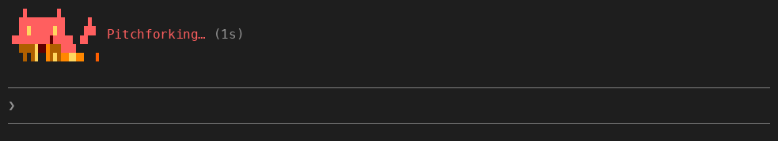
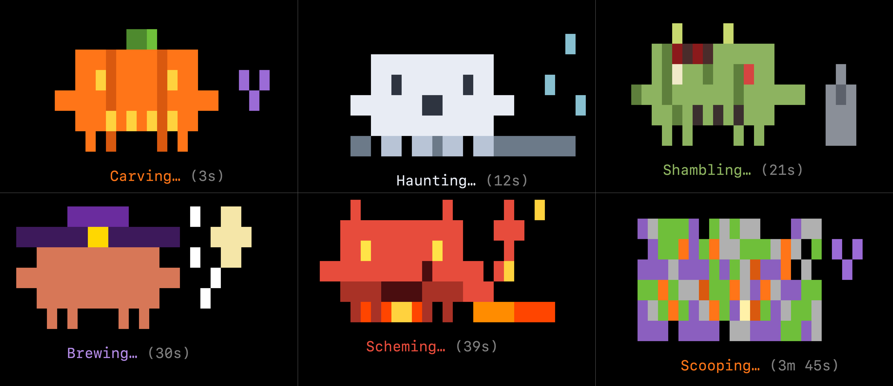

# claude-code-halloween

A Claude Code mod that haunts the spinner. While Claude works, a small
animated Clawd (the size of the welcome screen mascot, 3 rows by 12 columns)
takes the spinner's place and cycles through five Halloween costumes, nine
seconds each, swapping in a puff of smoke:

| Costume | Effects | Spinner words |
| --- | --- | --- |
| Pumpkin Clawd | carved face lit by a flickering candle, a stem, a flapping bat | Carving, Scooping, Flickering, Grinning |
| Ghost Clawd | bobs up and down, wavy sheet hem, drifting fog, faint sparkles | Haunting, Lurking, Creeping, Possessing, Spooking |
| Zombie Clawd | rotting green with a stitched scar, mismatched eyes, sways as he shambles, reaches out, flies buzz overhead, a tombstone | Shambling, Groaning, Lurching, Rotting, Braaaining |
| Witch Clawd | pointed hat with a gold buckle, glowing green eyes that blink, moon, stars, lightning | Brewing, Conjuring, Hexing, Bewitching, Cackling, Summoning |
| Devil Clawd | horns, glowing yellow eyes, a smirk, a swishing arrow tail, standing in hellfire with rising embers | Scheming, Tempting, Smoldering, Bargaining, Pitchforking |

The word beside him comes from his costume, so it changes with every costume
swap, and each costume moves on to its next word every time it comes around.
Nothing else on screen changes, and he is gone the moment the turn ends.




He also comes as a bigger macOS [screensaver](#screensaver).

## Install

```
/plugin install halloween --marketplace whirlwin/claude-code-halloween
```

Answer `y` to add the marketplace, then pick a scope.

## Update

`/plugin update` installs from the local clone of the marketplace and does
not fetch it first, so refresh the clone before updating:

```
claude plugin marketplace update claude-code-halloween
claude plugin update halloween@claude-code-halloween
```

Then run `/reload-plugins` in an open session, or restart Claude Code.

## Use

| Command | What it does |
| --- | --- |
| `/halloween` | hide Clawd, or bring him back |
| `/halloween next` | skip straight to the next costume |

## Screensaver

The same five costumes also come as a macOS screensaver, big enough to fill
the screen. It plays the mod's own frames, baked from `hooks/scene.ts` at
build time. Each quadrant pixel is drawn as a block twice as tall as it is
wide, like a terminal cell, so Clawd keeps his shape. Below him are the
costume's word and how long the screensaver has been running. He moves to a
new spot with every costume swap, behind the puff of smoke, so nothing burns
in.



Building needs macOS 13 or later, the Xcode command line tools and Node 22.18
or later (to run `scene.ts` without a compile step):

```
screensaver/build.sh --install
```

This builds `screensaver/build/Halloween Clawd.saver` and copies it into
`~/Library/Screen Savers`. Then pick Halloween Clawd in System Settings,
Screen Saver. Leave out `--install` to only build it.

`screensaver/render.swift` loads a built saver the way macOS does and renders
frames offscreen into one PNG. The build uses it for the thumbnails System
Settings shows, and it drew the picture above:

```
swift screensaver/render.swift "screensaver/build/Halloween Clawd.saver" docs/screensaver.png 756 491 20 85 140 200 260 1500
```

## How it works

Mods can only draw where Claude Code exposes a render site, and the welcome
screen logo is not one of them (as of Claude Code 2.1.296), so Clawd moves
into the spinner instead. He is a `Raster` of quadrant block glyphs traced
from the welcome screen, repainted with `$.ui.blit` on a 150 ms clock rather
than redrawing the whole tree.

Drawing a tree in the spinner's place drops what the engine draws after the
word (elapsed time, tokens, effort), so the mod shows its own elapsed time.
The token count is not shown. In the desktop app only the word changes.

## Develop

```
claude --plugin-dir .
claude plugin validate .
claude plugin test .
```

The plugin is named `halloween` rather than after the repository because
Claude Code reserves plugin names starting with `claude-`.

## License

MIT, see [LICENSE](LICENSE).
